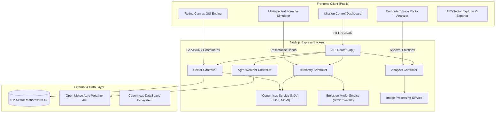

# 🛰️ Maharashtra Copernicus Sentinel-2 Agricultural Telemetry Platform

> **Class XI R&D Satellite Model**  
> An enterprise-grade multispectral remote sensing platform monitoring Crop Vigour (NDVI), Surface Humidity & Soil Moisture, and Field Greenhouse Gas Emissions across 152+ agricultural sectors in Maharashtra's 6 administrative divisions.

[](https://nodejs.org/)
[](https://dataspace.copernicus.eu/)
[](LICENSE)
[](tests/api.test.js)

---

## 🌟 Highlights & Upgrades

- **Dual-Engine GIS Mapping**: High-performance Retina Canvas GIS engine with river basin corridors (Bhima & Krishna), dynamic coordinate tracking, zoom/pan navigation, and sub-pixel inspection.
- **Modern Aerospace Mission-Control UI**: Complete aesthetic overhaul with dark/light mode toggle, glowing HUD telemetry widgets, live satellite ingestion indicators, and glassmorphic panels.
- **152+ Farmland Sectors**: Comprehensive spatial coverage across Wagholi/Pune Core, Paschim Maharashtra, Nashik/Khandesh, Marathwada, Vidarbha, and Konkan coastal belts.
- **Computer-Vision Field Photo Scanner**: Drag-and-drop field photo analyzer extracting green canopy, exposed soil, and moisture fractions with automatic sector matching and confidence scoring.
- **Production RESTful Backend**: Layered architecture in Express.js with automated test coverage (`node:test`), Open-Meteo live agro-weather integration, GeoJSON and CSV exporters.
- **Multi-Date Phenological Time Series**: DOY 102 (Pre-Sowing) to DOY 287 (Harvest) phenology trajectory with interactive curves.

---

## 📐 System Architecture



---

## 🚀 Quick Start Guide

### Prerequisites
- [Node.js](https://nodejs.org/) (v18+ recommended, tested on v24.21.0)
- npm (v9+)

### Installation & Launch

1. **Navigate to the project directory:**
   ```bash
   cd /Users/vedantpatil/.gemini/antigravity/scratch/maharashtra-copernicus-sentinel
   ```

2. **Install dependencies:**
   ```bash
   npm install
   ```

3. **Run the Automated Test Suite:**
   ```bash
   npm test
   ```
   *Expected output: All 7 integration tests passing.*

4. **Start the Application:**
   ```bash
   npm start
   ```
   Or run in hot-reloading development mode:
   ```bash
   npm run dev
   ```

5. **Open in Browser:**
   Visit [`http://localhost:3000`](http://localhost:3000)

> **💡 Offline Standalone Note**: The standalone single-file version at `/Users/vedantpatil/Downloads/index.html` has also been upgraded. You can double-click it directly from Finder or Downloads to run offline without starting any server!

---

## 📂 Project Directory Structure

```
maharashtra-copernicus-sentinel/
├── package.json               # Project manifest, dependencies & scripts
├── server.js                  # Express application entrypoint
├── public/                    # Frontend static distribution
│   └── index.html             # High-tech Mission Control SPA
├── src/
│   ├── controllers/           # Request handlers
│   │   ├── sectorController.js    # CRUD, GeoJSON, CSV & Spatial Aggregations
│   │   ├── telemetryController.js # Multispectral indices & GHG footprints
│   │   ├── analysisController.js  # Computer vision spectral scanning
│   │   └── weatherController.js   # Open-Meteo live agro-weather integration
│   ├── services/              # Scientific & mathematical services
│   │   ├── copernicusService.js   # Sentinel-2 formulas & phenology models
│   │   ├── emissionModelService.js# IPCC Tier-1/Tier-2 agricultural GHG flux
│   │   └── imageProcessingService.js# Pixel reflectance classifier
│   ├── data/
│   │   └── sectorsData.js     # 152+ Farmland sectors across 6 divisions
│   ├── routes/
│   │   └── api.js             # REST API routing definitions
│   └── middleware/
│       └── errorHandler.js    # Centralized API error handling
├── tests/
│   └── api.test.js            # Automated native integration tests
└── docs/
    ├── API_DOCUMENTATION.md   # Complete REST API specification
    └── SCIENTIFIC_METHODOLOGY.md # Spectral physics & remote sensing guide
```

---

## 🔬 Mathematical & Scientific Foundations

### 1. Normalized Difference Vegetation Index (NDVI)
Vegetation vigour is calculated using Sentinel-2 **Band 8 (NIR, 842nm)** and **Band 4 (Visible Red, 665nm)**:

$$\text{NDVI} = \frac{\rho_{\text{NIR}} - \rho_{\text{Red}}}{\rho_{\text{NIR}} + \rho_{\text{Red}}}$$

- **0.70 to 0.95**: Dense, healthy, vigorous crop canopy (Sugarcane, Paddy at tasseling)
- **0.40 to 0.69**: Moderate growth, developing foliage, or early jointing
- **0.20 to 0.39**: Sparse canopy or water-stressed vegetation
- **< 0.20**: Bare black cotton soil, fallow fields, or post-harvest stubble

### 2. Soil-Adjusted Vegetation Index (SAVI)
Minimizes soil background reflectance during early growth stages ($L = 0.5$):

$$\text{SAVI} = \frac{\rho_{\text{NIR}} - \rho_{\text{Red}}}{\rho_{\text{NIR}} + \rho_{\text{Red}} + L} \times (1 + L)$$

### 3. Agricultural Greenhouse Gas Emissions
Calibrated with IPCC 100-Year Global Warming Potential (GWP AR6):
- $\text{N}_2\text{O}$: GWP = 273 (From nitrogen fertilizers and volatilization)
- $\text{CH}_4$: GWP = 27.9 (From anaerobic methanogenesis in flooded rice paddies)
- $\text{CO}_2$: GWP = 1 (From microbial heterotrophic respiration)

$$\text{Total CO}_2\text{e} = (M_{\text{CO}_2} \times 1) + (M_{\text{CH}_4} \times 27.9) + (M_{\text{N}_2\text{O}} \times 273)$$

---

## 🌐 API Overview

| Method | Endpoint | Description |
| :--- | :--- | :--- |
| `GET` | `/api/health` | Server health check and version metadata |
| `GET` | `/api/sectors` | Query 152+ sectors with division, crop, and NDVI filters |
| `GET` | `/api/sectors/:id` | Fetch detailed telemetry & 6-stage phenology series |
| `POST` | `/api/sectors` | Ingest a new custom agricultural parcel |
| `GET` | `/api/sectors/stats/summary` | Aggregate statistics across Maharashtra |
| `GET` | `/api/export/geojson` | Export standard GeoJSON FeatureCollection |
| `GET` | `/api/export/csv` | Download tabular CSV dataset |
| `POST` | `/api/analysis/scan-photo` | Analyze spectral fractions and match closest sector |
| `POST` | `/api/telemetry/indices` | Calculate NDVI, SAVI, NDMI, and NDWI |
| `GET` | `/api/weather/:district` | Live agro-meteorological observations |

*For complete curl commands and schemas, see [docs/API_DOCUMENTATION.md](docs/API_DOCUMENTATION.md).*

---

## 📄 License
This project is open-source under the MIT License.
Developed for Class XI R&D Satellite Remote Sensing & Climate-Smart Agriculture.
